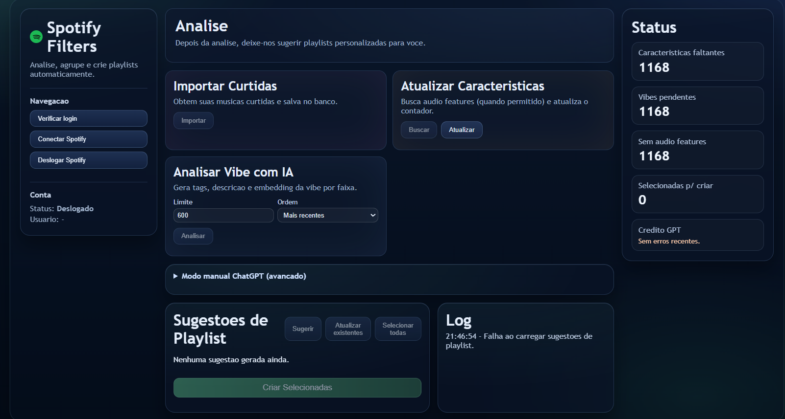
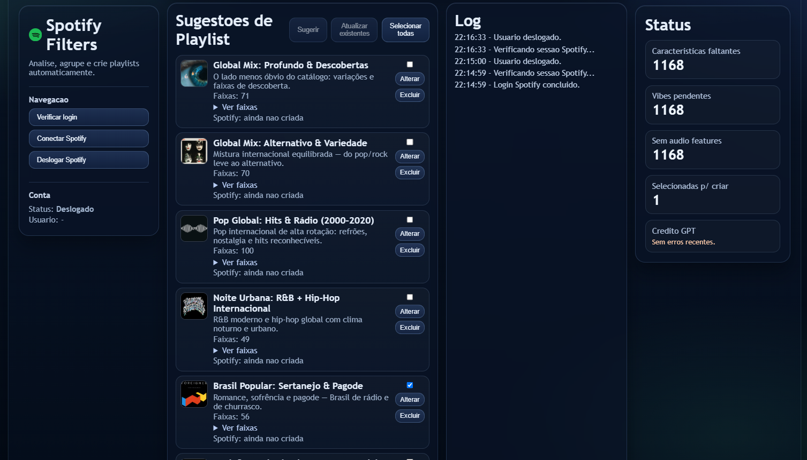

# Spotify Filters

Aplicação web que lê as músicas curtidas de uma conta do Spotify, classifica a vibe de cada faixa e devolve isso agrupado em playlists sugeridas — que podem ser criadas direto na conta.

O login é feito pelo próprio Spotify (OAuth PKCE): a aplicação manda para a tela de autorização e, na volta, usa o token para puxar a biblioteca pela Web API.

**Stack:** Next.js (App Router) · TypeScript · Prisma + SQLite · Spotify Web API · OpenAI API



## Dois modos de análise

**Automático** — com uma `OPENAI_API_KEY` configurada, a própria aplicação analisa cada faixa e gera tags, descrição e embedding da vibe.

**Manual** — para usar sem API paga. A aplicação exporta um JSON com os dados das faixas, você joga esse arquivo em qualquer chat de IA e cola o retorno de volta. O formato de saída é o mesmo que o modo automático produz, então o resto do fluxo não muda.



## Funcionalidades

- Login no Spotify com OAuth PKCE
- Importação das curtidas com paginação
- Persistência de tracks, artists e audio features em SQLite
- Análise de vibe por faixa (tags, resumo, embedding)
- Sugestão de playlists por clustering
- Criação das playlists selecionadas na conta do Spotify
- Edição e exclusão de sugestões antes de criar
- Atualização de playlists já existentes com as músicas novas
- Exportação e importação do pacote manual
- Limpeza das playlists de debug (`_debug`)

## Fluxo

1. Conectar Spotify
2. Importar curtidas
3. Buscar características de áudio
4. Analisar vibe com IA — ou usar o modo manual
5. Sugerir playlists
6. Criar as selecionadas
7. Quando surgirem músicas novas: importar de novo e usar **Atualizar existentes**

## Rodando local

```bash
npm install
copy .env.example .env
```

Variáveis do `.env`:

| Variável | Para quê |
|---|---|
| `DATABASE_URL` | Caminho do SQLite |
| `SPOTIFY_CLIENT_ID` | Client ID do app no Spotify Developer Dashboard |
| `SPOTIFY_REDIRECT_BASE_URL` | Base do redirect de callback do OAuth |
| `OPENAI_API_KEY` | Só no modo automático |

Depois:

```bash
npm run prisma:migrate
npm run dev
```

A aplicação sobe em `http://127.0.0.1:3001`.

Para limpar o cache do `.next` antes de subir, use `npm run dev:clean`. Para produção local, `npm run build` e `npm run start`.

## Scripts

`dev` · `dev:clean` · `build` · `start` · `test` · `prisma:migrate` · `prisma:studio`

## Endpoints

| Área | Rotas |
|---|---|
| Auth | `/api/auth/login`, `/api/auth/callback`, `/api/auth/me`, `/api/auth/logout` |
| Importação | `/api/import/liked` |
| Enriquecimento | `/api/enrich/audio-features` |
| Análise | `/api/analyze/vibe` |
| Sugestões | `/api/playlists/suggest`, `/api/playlists/suggest/[id]` |
| Criação e sincronização | `/api/playlists/create`, `/api/playlists/sync-existing` |
| Modo manual | `/api/manual/chatgpt-export`, `/api/manual/chatgpt-import` |
| Utilitários | `/api/playlists/cleanup-debug`, `/api/health` |
